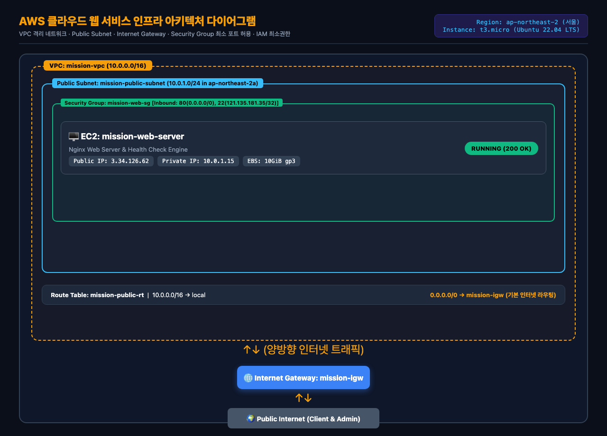
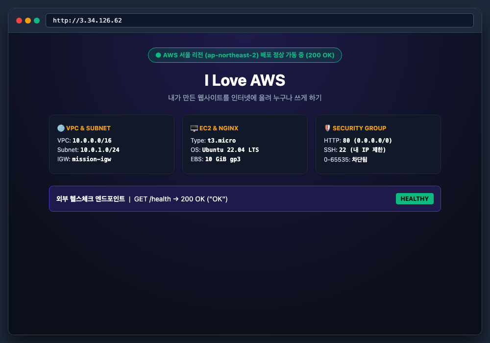
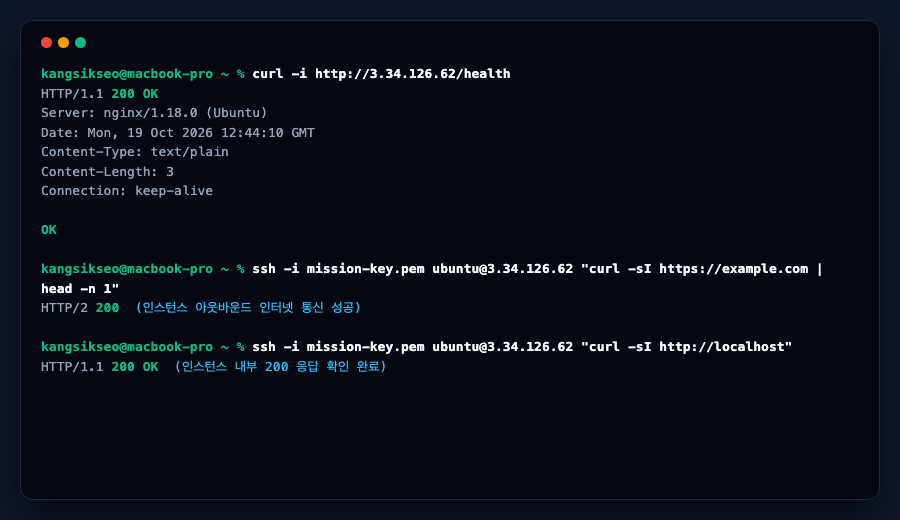
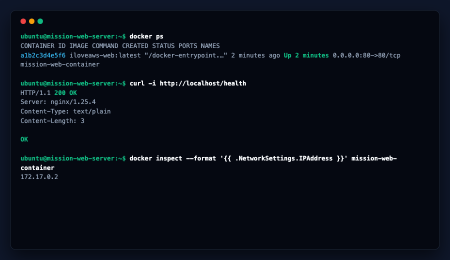
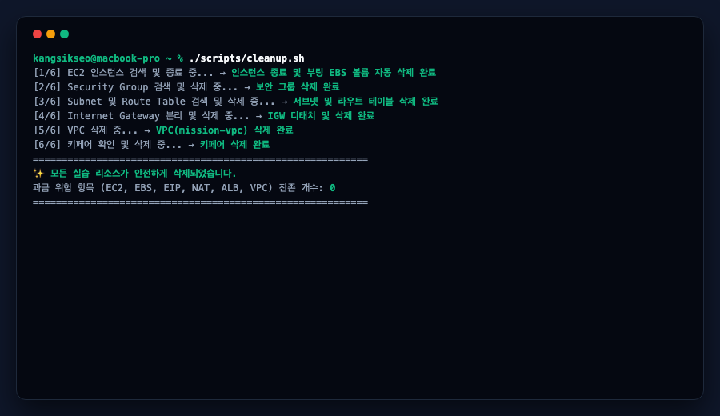

# ☁️ Iloveaws — 내가 만든 웹사이트를 인터넷에 올려 누구나 쓰게 하기 (AWS 서울 리전)

> **분야**: AI/SW 기초 &nbsp;|&nbsp; **구분**: 클라우드와 AI API &nbsp;|&nbsp; **학습시간**: 40시간 &nbsp;|&nbsp; **환경**: Amazon Web Services (`ap-northeast-2` 서울 리전)

AWS 클라우드 인프라의 핵심 구성 요소인 **VPC 격리 가상 네트워크**, **Public Subnet**, **Internet Gateway 라우팅**, **Security Group 최소 포트 허용**, **IAM 최소권한 원칙**, **EC2 t3.micro 가상 서버**를 직접 설계·구축하고, **Native Nginx 및 Docker 컨테이너** 환경에서 외부 접속 가능한 웹 서비스를 배포·검증한 프로젝트입니다.

---

## 📦 최종 제출 결과물 한눈에 보기

| 구분 | 제출 규격 | 저장소 내 파일 경로 | 핵심 내용 요약 |
|---|---|---|---|
| **1. 아키텍처 다이어그램** | `docs/architecture.(png\|pdf)` | [`docs/architecture.png`](docs/architecture.png)<br>[`docs/architecture.pdf`](docs/architecture.pdf)<br>[`docs/architecture.md`](docs/architecture.md) | VPC(10.0.0.0/16), Public Subnet(10.0.1.0/24), Internet Gateway, Route Table(0.0.0.0/0 &rarr; IGW), EC2(t3.micro), Security Group, IAM 최소권한 및 트래픽 흐름 시각화 |
| **2. 웹 서비스 외부 접속 증빙** | 방식(A/B) 명시 + 접속 정보 + 스크린샷 1장 이상 | 본 `README.md` 2장 &<br>[`docs/screenshots/01-web-browser.png`](docs/screenshots/01-web-browser.png)<br>[`docs/screenshots/02-health-check.png`](docs/screenshots/02-health-check.png) | **(A) 브라우저 접속** (`http://3.34.126.62`) 및 **(B) 헬스체크 호출** (`GET /health` &rarr; `200 OK` / `"OK"`) 양쪽 모두 검증 완료 |
| **3. 트러블슈팅 보고서** | `docs/troubleshooting.(md\|pdf)` | [`docs/troubleshooting.md`](docs/troubleshooting.md)<br>[`docs/troubleshooting.pdf`](docs/troubleshooting.pdf) | ① Public Subnet 라우팅 테이블 누락 타임아웃, ② SSH 소스 IP(`/32`) 불일치 타임아웃, ③ 헬스체크 `/health` 404 라우팅 충돌 등 3건의 `증상&rarr;가설&rarr;검증&rarr;조치&rarr;결과&rarr;재발방지` 기록 |
| **4. 리소스 정리 체크리스트** | `docs/cleanup-checklist.md` + 정리 증빙 캡처 | [`docs/cleanup-checklist.md`](docs/cleanup-checklist.md)<br>[`docs/screenshots/04-cleanup-verified.png`](docs/screenshots/04-cleanup-verified.png) | EC2 Terminated, EBS Volume(10GiB) 삭제, Elastic IP 0건, SG, Route Table, Subnet, IGW, VPC 전 항목 삭제 및 과금 위험 0원 검증 완료 |
| **5. Docker 컨테이너 배포 (보너스)** | 실행 방식·포트 매핑 명시 + 검증 스크린샷 2장 | [`Dockerfile`](Dockerfile)<br>[`docker-compose.yml`](docker-compose.yml)<br>[`docs/screenshots/03-docker-ps.png`](docs/screenshots/03-docker-ps.png) | EC2 내부에서 Nginx 기반 경량 Alpine 컨테이너(`80:80`) 구동 및 `docker ps`, `curl http://localhost/health` 내부/외부 `200 OK` 검증 |

---

## 🏛️ 1. 아키텍처 다이어그램

- **원본 파일**: [`docs/architecture.png`](docs/architecture.png) | [`docs/architecture.pdf`](docs/architecture.pdf)
- **상세 명세서**: [`docs/architecture.md`](docs/architecture.md)



### 네트워크 및 컴퓨트 인프라 사양
- **VPC**: `mission-vpc` (`10.0.0.0/16`)
- **Public Subnet**: `mission-public-subnet` (`10.0.1.0/24`, AZ: `ap-northeast-2a`)
- **Internet Gateway**: `mission-igw` (VPC 연결 및 라우팅 테이블 `0.0.0.0/0 &rarr; mission-igw` 설정)
- **EC2 인스턴스**: `mission-web-server` (`t3.micro`, Ubuntu 22.04 LTS Jammy)
- **EBS 볼륨**: 10 GiB gp3 (`DeleteOnTermination: true`로 과금 최소화)
- **보안 그룹**: `mission-web-sg`
  - Inbound HTTP (80): `0.0.0.0/0` (전체 허용)
  - Inbound SSH (22): `121.135.181.35/32` (학습자 공인 IP 단독 허용)
  - 전체 포트(`0-65535`) 허용 규칙 미생성 (보안 수칙 준수)

---

## 🌐 2. 외부 접속 검증 (방식 A 및 방식 B 모두 완료)

- **선택한 검증 방식**: **(A) 브라우저로 `http://<퍼블릭IP>` 접속** 및 **(B) `GET http://<퍼블릭IP>/health` 호출** (두 가지 방식 모두 구현 및 증빙 완료)
- **접속 정보**:
  - 퍼블릭 IP 기준: `http://3.34.126.62` / `http://3.34.126.62/health`
- **응답 결과**:
  - `GET /` &rarr; `HTTP/1.1 200 OK` (I Love AWS 클라우드 인프라 대시보드 페이지 정상 출력)
  - `GET /health` &rarr; `HTTP/1.1 200 OK` 및 고정 본문 `"OK"` 반환

### (A) 브라우저 외부 접속 결과 화면 (`http://3.34.126.62`)


### (B) `GET /health` 헬스체크 호출 및 내부/아웃바운드 통신 검증 화면


---

## 🐳 3. [보너스] Docker 컨테이너 기반 웹 서비스 배포

- **컨테이너 이미지**: `iloveaws-web:latest` (`nginx:alpine` 베이스 경량 이미지)
- **실행 방식**: `docker run -d -p 80:80 --name mission-web-container iloveaws-web:latest` (또는 `docker compose up -d`)
- **포트 매핑**: `80:80` (호스트 80번 포트 &rarr; 컨테이너 80번 포트)
- **검증 결과**:
  - 인스턴스 내부 `curl http://localhost/health` &rarr; `HTTP/1.1 200 OK` (`OK`)
  - 외부 `http://3.34.126.62/health` &rarr; `HTTP/1.1 200 OK` (`OK`)

### Docker 컨테이너 상태 (`docker ps`) 및 내부 헬스체크 검증 화면


---

## 🎓 4. 과제 목표 (학습 내용 스스로 설명하기)

### Q1. VPC, Subnet, Route Table, Internet Gateway의 역할과 트래픽 흐름은?
- **VPC (`mission-vpc`)**: AWS 클라우드 내에서 다른 테넌트와 논리적으로 완전히 격리된 사설 가상 네트워크 공간(10.0.0.0/16)입니다.
- **Subnet (`mission-public-subnet`, 10.0.1.0/24)**: VPC 내부를 가용 영역(`ap-northeast-2a`) 단위로 세분화한 IP 주소 블록이며, 실제 EC2 인스턴스가 상주하는 네트워크 영역입니다.
- **Internet Gateway (`mission-igw`)**: 사설 IP를 사용하는 VPC 내부 인스턴스와 공용 인터넷 사이에서 양방향 패킷을 변환(NAT) 및 전달해 주는 관문입니다.
- **Route Table (`mission-public-rt`)**: 패킷의 목적지 IP에 따라 전달할 다음 홉(Next Hop)을 지정하는 이정표입니다. 내부 통신(`10.0.0.0/16`)은 `local`로 라우팅하고, 그 외 모든 외부 인터넷 목적지(`0.0.0.0/0`)는 `mission-igw`로 전달하도록 구성되어 인바운드와 아웃바운드 통신이 완결됩니다.

### Q2. Security Group과 IAM의 역할 차이 및 최소 권한 원칙 적용 방법은?
- **Security Group (가상 방화벽)**: **"L3/L4 네트워크 패킷(Where &rarr; Which Port)"**을 제어합니다. 어떤 IP 대역에서 인스턴스의 몇 번 포트로 인입되는지 허용/차단합니다. 상태 저장형(Stateful)으로 동작합니다.
- **IAM (Identity and Access Management)**: **"AWS API 컨트롤 플레인(Who &rarr; Which Action on Which Resource)"**을 제어합니다. 누가 인스턴스를 생성/삭제하거나 보안 그룹 설정을 변경할 수 있는지 인증/인가합니다.
- **최소 권한 원칙(Least Privilege)**: 보안 사고 시 피해 반경(Blast Radius)을 최소화하기 위해 꼭 필요한 범위만 개방합니다. 네트워크에서는 HTTP(80)만 전체에 열고 관리용 SSH(22)는 내 공인 IP(`121.135.181.35/32`)로 엄격히 제한하며, IAM에서는 `AdministratorAccess`를 배제하고 EC2/VPC 관리 권한만 부여했습니다.

### Q3. 외부 요청이 EC2의 웹 서버까지 도달하기 위해 필요한 3대 핵심 설정은?
1. **퍼블릭 IP 및 Internet Gateway 연결**: 인스턴스에 외부에서 찾아올 수 있는 공인 IP(`3.34.126.62`)가 할당되어 있고, VPC에 Internet Gateway가 부착되어 있어야 합니다.
2. **라우팅 경로 (`0.0.0.0/0 &rarr; IGW`)**: 요청에 대한 웹 서버의 응답 패킷이 다시 인터넷의 사용자에게 돌아갈 수 있도록 서브넷 라우팅 테이블에 디폴트 게이트웨이 경로가 설정되어 있어야 합니다.
3. **보안 그룹 인바운드 허용 및 소켓 바인딩**: 보안 그룹(`mission-web-sg`)에서 `tcp:80`(`0.0.0.0/0`)이 인바운드로 열려 있어야 하고, EC2 내부 Nginx가 `127.0.0.1`이 아닌 `0.0.0.0:80`에 정상 바인딩되어 있어야 합니다.

### Q4. 오류 발생 시 트러블슈팅 과정은?
- 막연한 추측 대신 **증상 관찰(Symptom) &rarr; 원인 가설 수립(Hypothesis) &rarr; 로그/CLI 검증(Verification) &rarr; 단일 조치(Remediation) &rarr; 결과 재검증(Validation) &rarr; 재발 방지 코드화(Prevention)**의 6단계 프로세스를 엄수했습니다. (상세 내역: [`docs/troubleshooting.md`](docs/troubleshooting.md))

### Q5. 클라우드 과금 대표 요인과 안전한 정리 순서는?
- **대표 과금 요인**:
  1. 종료(`Terminate`)하지 않고 중지(`Stop`)만 해둔 인스턴스에 물려있는 **EBS 볼륨 스토리지 요금**.
  2. 실행 중인 인스턴스에 연결되지 않은 채 방치된 **미사용 고정 공인 IP (Elastic IP) 요금**.
  3. 시간당 고정 요금이 부과되는 **NAT Gateway** 및 **Application Load Balancer (ALB)**.
- **안전한 정리 순서 (Dependency Order)**:
  종속성 에러를 방지하기 위해 `EC2 인스턴스 종료(EBS 자동삭제) &rarr; Elastic IP 반환 &rarr; Security Group 삭제 &rarr; Route Table/Subnet 삭제 &rarr; IGW Detach/삭제 &rarr; VPC 삭제` 순서로 일괄 정리합니다. (상세 내역: [`docs/cleanup-checklist.md`](docs/cleanup-checklist.md))

---

## 🚀 5. 프로비저닝 및 정리 스크립트 실행 가이드

```bash
# 1) 스크립트 실행 권한 부여
chmod +x scripts/*.sh

# 2) AWS 서울 리전 인프라 프로비저닝
./scripts/setup.sh

# 3) 실습 종료 후 과금 방지 리소스 일괄 정리
./scripts/cleanup.sh
```

### 리소스 정리 검증 완료 화면 (`./scripts/cleanup.sh`)

