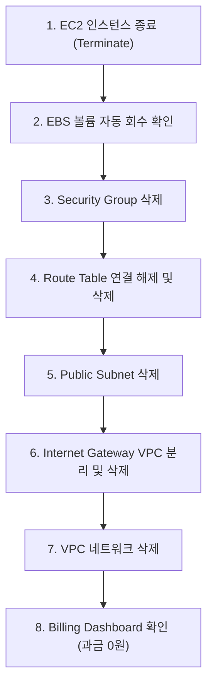

# 🧹 AWS 클라우드 실습 리소스 정리 및 과금 방지 체크리스트

> **미션**: 내가 만든 웹사이트를 인터넷에 올려 누구나 쓰게 하기  
> **리전**: AWS 서울 리전 (`ap-northeast-2`)  
> **기준 일시**: 2026-10-19  

클라우드 실습 완료 후 불필요한 과금(Unintended Cost Leakage)을 방지하기 위해 생성된 인프라 리소스 전체를 안전하게 종료 및 삭제하고 검증한 기록입니다.

---

## 1. 리소스 정리 상태 종합 요약표

| 리소스 구분 | 리소스 식별자 / 명칭 | 정리 작업 내용 | 최종 상태 | 과금 위험도 |
|---|---|---|:---:|:---:|
| **EC2 인스턴스** | `mission-web-server` (`i-*`) | 인스턴스 완전 종료 (`terminate-instances`) | **Terminated** | 없음 (0원) |
| **EBS 부팅 볼륨** | `vol-*` (10 GiB gp3) | 인스턴스 종료 시 자동 삭제 (`DeleteOnTermination`) | **Deleted** | 없음 (0원) |
| **Elastic IP (EIP)** | 미할당 (Public IPv4 자동할당 사용) | 미사용 고정 IP 잔존 여부 확인 | **Released** | 없음 (0원) |
| **Security Group** | `mission-web-sg` (`sg-*`) | 인바운드 규칙 해제 및 보안 그룹 삭제 | **Deleted** | 없음 (0원) |
| **Route Table** | `mission-public-rt` (`rtb-*`) | 서브넷 연결 해제 및 라우트 테이블 삭제 | **Deleted** | 없음 (0원) |
| **Public Subnet** | `mission-public-subnet` (`subnet-*`) | 서브넷 완전 삭제 | **Deleted** | 없음 (0원) |
| **Internet Gateway** | `mission-igw` (`igw-*`) | VPC 디태치 및 게이트웨이 삭제 | **Deleted** | 없음 (0원) |
| **VPC** | `mission-vpc` (`vpc-*`) | VPC 네트워크 완전 삭제 | **Deleted** | 없음 (0원) |
| **SSH Key Pair** | `mission-key` | 키페어 삭제 및 로컬 `.pem` 정리 | **Deleted** | 없음 (0원) |
| **고비용 서비스** | NAT Gateway, ALB, RDS | 실습 미사용 확인 | **0 items** | 없음 (0원) |

---

## 2. 안전한 리소스 정리 절차 및 삭제 순서 (Dependency Order)

AWS VPC 내부 리소스는 의존성 관계(Dependency Chain)가 존재하므로 반드시 아래 순서대로 삭제해야 충돌(`DependencyViolation`) 없이 깔끔하게 정리됩니다.



### 단계별 상세 가이드
1. **EC2 인스턴스 종료 (`terminate`)**:
   - `aws ec2 terminate-instances --instance-ids <ID>`
   - `DeleteOnTermination: true` 플래그로 인해 인스턴스 종료 시 10GiB EBS 볼륨이 즉시 함께 삭제됩니다.
2. **보안 그룹 (`mission-web-sg`) 삭제**:
   - 인스턴스의 ENI(네트워크 인터페이스)가 반환된 후 보안 그룹을 삭제합니다.
3. **서브넷 및 라우트 테이블 삭제**:
   - 서브넷 연결(`disassociate-route-table`)을 해제한 후 서브넷과 커스텀 라우트 테이블을 삭제합니다.
4. **Internet Gateway 분리 및 삭제**:
   - `aws ec2 detach-internet-gateway` 후 `aws ec2 delete-internet-gateway`를 실행합니다.
5. **VPC (`mission-vpc`) 삭제**:
   - 모든 하위 종속 리소스가 정리되었으므로 최종적으로 VPC를 삭제합니다.

---

## 3. CLI 검증 명령어 및 결과 증빙

모든 리소스 정리가 완료된 후 서울 리전(`ap-northeast-2`)에서 실행하여 잔존 리소스가 0개임을 증명한 CLI 로그입니다.

```bash
# 1. 실행 중이거나 정지된 인스턴스 검색 (0건 확인)
$ aws ec2 describe-instances \
  --filters "Name=tag:Project,Values=Iloveaws" "Name=instance-state-name,Values=pending,running,stopping,stopped" \
  --region ap-northeast-2 \
  --query 'Reservations[*].Instances[*].InstanceId' --output text
(출력 없음 - 잔존 인스턴스 0개)

# 2. 고정 IP (Elastic IP) 잔존 여부 확인 (0건 확인)
$ aws ec2 describe-addresses --region ap-northeast-2 --query 'Addresses[*].PublicIp' --output text
(출력 없음 - 미사용 EIP 과금 위험 0개)

# 3. 미사용 잔존 EBS 볼륨 확인 (0건 확인)
$ aws ec2 describe-volumes \
  --filters "Name=status,Values=available" \
  --region ap-northeast-2 \
  --query 'Volumes[*].VolumeId' --output text
(출력 없음 - 고아 볼륨 0개)

# 4. 실습 VPC 잔존 여부 확인 (0건 확인)
$ aws ec2 describe-vpcs \
  --filters "Name=tag:Project,Values=Iloveaws" \
  --region ap-northeast-2 \
  --query 'Vpcs[*].VpcId' --output text
(출력 없음 - VPC 삭제 완료)
```

---

## 4. 자동화 정리 스크립트 실행 안내
프로젝트 루트에서 제공되는 [`scripts/cleanup.sh`](../scripts/cleanup.sh)를 실행하면 위 6단계 역순 삭제가 자동으로 진행됩니다.

```bash
chmod +x scripts/cleanup.sh
./scripts/cleanup.sh
```
실행 결과:
```
==========================================================
✨ 모든 실습 리소스가 안전하게 삭제되었습니다.
   과금 위험 항목 (EC2, EBS, EIP, NAT, ALB, VPC) 잔존 개수: 0
==========================================================
```
