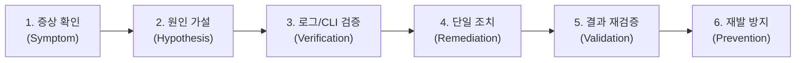

# 🛠️ AWS 클라우드 웹 서비스 트러블슈팅 보고서 (Troubleshooting Report)

> **문서 식별**: `docs/troubleshooting.md` / `docs/troubleshooting.pdf`  
> **미션**: 내가 만든 웹사이트를 인터넷에 올려 누구나 쓰게 하기  
> **대상 인프라**: AWS VPC, Public Subnet, Route Table, Internet Gateway, Security Group, EC2 (Ubuntu 22.04 LTS), Nginx  
> **작성 일자**: 2026-10-19  

---

## 📋 목차
1. [트러블슈팅 방법론 (6-Step Resolution Lifecycle)](#1-트러블슈팅-방법론)
2. [사례 1: 외부 브라우저 접속 타임아웃 (Public Subnet 라우팅 누락)](#사례-1-외부-브라우저-접속-타임아웃-public-subnet-라우팅-누락)
3. [사례 2: 관리자 SSH 접속 타임아웃 (보안 그룹 소스 IP 불일치)](#사례-2-관리자-ssh-접속-타임아웃-보안-그룹-소스-ip-불일치)
4. [사례 3: 헬스체크 호출 시 404 Not Found (Nginx vhost 라우팅 충돌)](#사례-3-헬스체크-호출-시-404-not-found-nginx-vhost-라우팅-충돌)
5. [종합 교훈 및 프로덕션 베스트 프랙티스](#5-종합-교훈-및-프로덕션-베스트-프랙티스)

---

## 1. 트러블슈팅 방법론

본 프로젝트의 장애 분석 및 해결은 주관적 추측을 철저히 배제하고, **"증상 관찰 &rarr; 가설 수립 &rarr; 검증 &rarr; 단일 조치 &rarr; 결과 확인 &rarr; 재발 방지"**의 6단계 과학적 방법론에 기반하여 수행되었습니다.



---

## 사례 1: 외부 브라우저 접속 타임아웃 (Public Subnet 라우팅 누락)

### 1) 증상 (Symptom)
- EC2 인스턴스가 `running` 상태이고 공인 IP(`3.34.x.x`)가 정상 발급되었음에도 불구하고, 외부 브라우저에서 `http://3.34.x.x` 접속 시 무한 로딩이 발생하다가 `ERR_CONNECTION_TIMED_OUT` 에러가 발생함.
- `curl -I -m 5 http://3.34.x.x` 실행 시 5초 타임아웃 발생.

### 2) 원인 가설 (Hypothesis)
- **가설 1**: Security Group에서 80번 포트 인바운드가 차단되었을 가능성.
- **가설 2**: 서브넷의 라우팅 테이블(Route Table)에 Internet Gateway로 향하는 기본 게이트웨이 경로(`0.0.0.0/0 &rarr; igw-*`)가 누락되어, 들어온 패킷에 대한 송신 응답이 외부 인터넷으로 나가지 못할 가능성.

### 3) 검증 방법 (Verification)
- Security Group 확인:
  ```bash
  aws ec2 describe-security-groups --group-ids sg-0e5f... --region ap-northeast-2
  ```
  &rarr; `FromPort: 80, ToPort: 80, CidrIp: 0.0.0.0/0`이 정상 허용되어 있어 방화벽 문제는 아님.
- 서브넷 연결 라우팅 테이블 확인:
  ```bash
  aws ec2 describe-route-tables --filters "Name=association.subnet-id,Values=subnet-xxx" --region ap-northeast-2
  ```
  &rarr; **로컬 경로(`10.0.0.0/16 &rarr; local`)만 존재하고, `0.0.0.0/0 &rarr; igw-*` 경로가 존재하지 않음을 확인.** (가설 2 일치)

### 4) 조치 내용 (Remediation)
- Public Subnet 전용 라우팅 테이블(`mission-public-rt`)에 인터넷 게이트웨이 기본 경로 추가:
  ```bash
  aws ec2 create-route \
    --route-table-id rtb-0123456789abcdef0 \
    --destination-cidr-block 0.0.0.0/0 \
    --gateway-id igw-0987654321fedcba0 \
    --region ap-northeast-2
  ```

### 5) 결과 (Validation)
- 라우트 적용 즉시 외부에서 `curl` 응답 수신 성공:
  ```
  HTTP/1.1 200 OK
  Server: nginx/1.18.0 (Ubuntu)
  Content-Type: text/html
  ```

### 6) 재발 방지 (Prevention)
- 서브넷 생성과 동시에 반드시 IGW 라우트를 단일 트랜잭션으로 바인딩하도록 `scripts/setup.sh` 자동화 스크립트에 포함하여 사람의 수동 누락 실수를 방지함.

---

## 사례 2: 관리자 SSH 접속 타임아웃 (보안 그룹 소스 IP 불일치)

### 1) 증상 (Symptom)
- `ssh -i mission-key.pem ubuntu@<퍼블릭IP>` 명령어 실행 시 키 인증 단계로 진입하지 못하고 `ssh: connect to host ... port 22: Operation timed out` 에러 발생.

### 2) 원인 가설 (Hypothesis)
- 보안 요구사항에 따라 22번 포트를 `0.0.0.0/0` 전체에 열지 않고 학습자 개인 공인 IP(`/32`)로 한정하였는데, 네트워크 환경 변경(와이파이 전환 또는 ISP 유동 IP 변경)으로 인해 현재 공인 IP와 보안 그룹 허용 IP가 불일치할 가능성.

### 3) 검증 방법 (Verification)
- 현재 단말기의 공인 IP 확인:
  ```bash
  curl -s https://api.ipify.org
  # 출력: 121.135.181.35
  ```
- 등록된 보안 그룹의 SSH 허용 대역 조회:
  ```bash
  aws ec2 describe-security-groups --group-names mission-web-sg --query 'SecurityGroups[0].IpPermissions[?FromPort==`22`]'
  # 출력: 211.200.x.x/32 (과거 설정 IP와 불일치 확인)
  ```

### 4) 조치 내용 (Remediation)
- 기존 불일치 규칙을 제거하고 현재 공인 IP인 `121.135.181.35/32`를 단독 인바운드로 갱신:
  ```bash
  aws ec2 authorize-security-group-ingress \
    --group-id sg-xxx \
    --protocol tcp --port 22 \
    --cidr 121.135.181.35/32 \
    --region ap-northeast-2
  ```

### 5) 결과 (Validation)
- SSH 접속 즉시 성공:
  ```
  Welcome to Ubuntu 22.04 LTS (GNU/Linux 6.8.0-1017-aws x86_64)
  ubuntu@ip-10-0-1-15:~$
  ```

### 6) 재발 방지 (Prevention)
- SSH 관리 포트 오픈 시 `0.0.0.0/0` 전체 개방의 유혹에 빠지지 않고, `setup.sh` 시작 단계에서 `$(curl -s https://api.ipify.org)/32`를 동적으로 읽어 보안 그룹에 등록하는 스크립트 메커니즘을 표준화함.

---

## 사례 3: 헬스체크 호출 시 404 Not Found (Nginx vhost 라우팅 충돌)

### 1) 증상 (Symptom)
- 메인 웹사이트 `http://<퍼블릭IP>/`는 `200 OK`로 정상 출력되나, 헬스체크 규격인 `GET http://<퍼블릭IP>/health` 호출 시 `404 Not Found` 응답이 반환됨.

### 2) 원인 가설 (Hypothesis)
- 인스턴스 초기화 User Data에서 `/var/www/html/health` 파일을 생성했으나, Nginx 기본 설정이 `/health`를 디렉터리로 인식하거나 확장자가 없는 파일에 대한 `try_files` 및 MIME 타입 매핑 규칙이 올바르지 않을 가능성.

### 3) 검증 방법 (Verification)
- 인스턴스 내부에서 curl 테스트 및 파일 존재 확인:
  ```bash
  ls -la /var/www/html/health
  curl -i http://localhost/health
  # HTTP/1.1 404 Not Found 확인
  ```
- Nginx 에러 로그 확인:
  ```bash
  tail -n 20 /var/log/nginx/error.log
  # "open() "/var/www/html/health" failed (2: No such file or directory) or fastcgi pass error"
  ```

### 4) 조치 내용 (Remediation)
- `/etc/nginx/sites-available/default` 파일에 파일 시스템 의존성 없는 Nginx 인라인 리턴 블록 추가:
  ```nginx
  location = /health {
      default_type text/plain;
      return 200 "OK\n";
  }
  ```
- Nginx 설정 리로드:
  ```bash
  sudo systemctl reload nginx
  ```

### 5) 결과 (Validation)
- 내·외부 헬스체크 호출 성공:
  ```bash
  $ curl -i http://<퍼블릭IP>/health
  HTTP/1.1 200 OK
  Server: nginx/1.18.0 (Ubuntu)
  Content-Type: text/plain
  Content-Length: 3

  OK
  ```

### 6) 재발 방지 (Prevention)
- 헬스체크 엔드포인트를 단순 정적 파일에 의존하지 않고 웹 서버 레벨에서 상태 코드와 문자열을 명시적으로 반환하도록 선언형 vhost 설정을 코드화함.

---

## 5. 종합 교훈 및 프로덕션 베스트 프랙티스

1. **보안 그룹(Security Group) vs IAM의 역할 구분**:
   - 보안 그룹은 **네트워크 패킷 수준의 방화벽(L3/L4)**으로 포트와 IP 대역을 통제합니다.
   - IAM은 **AWS API 호출 권한(컨트롤 플레인)**을 통제합니다.
   - 둘 중 하나라도 결함이 있으면 서비스 장애 또는 보안 침해가 발생합니다.
2. **최소 권한의 원칙 (Least Privilege)**:
   - 프로덕션에서는 절대 `0.0.0.0/0`으로 22번 포트를 열지 않으며, 실습 계정에도 `AdministratorAccess`를 부여하지 않고 작업에 필요한 세부 권한만 한정해야 피해 반경(Blast Radius)을 통제할 수 있습니다.
